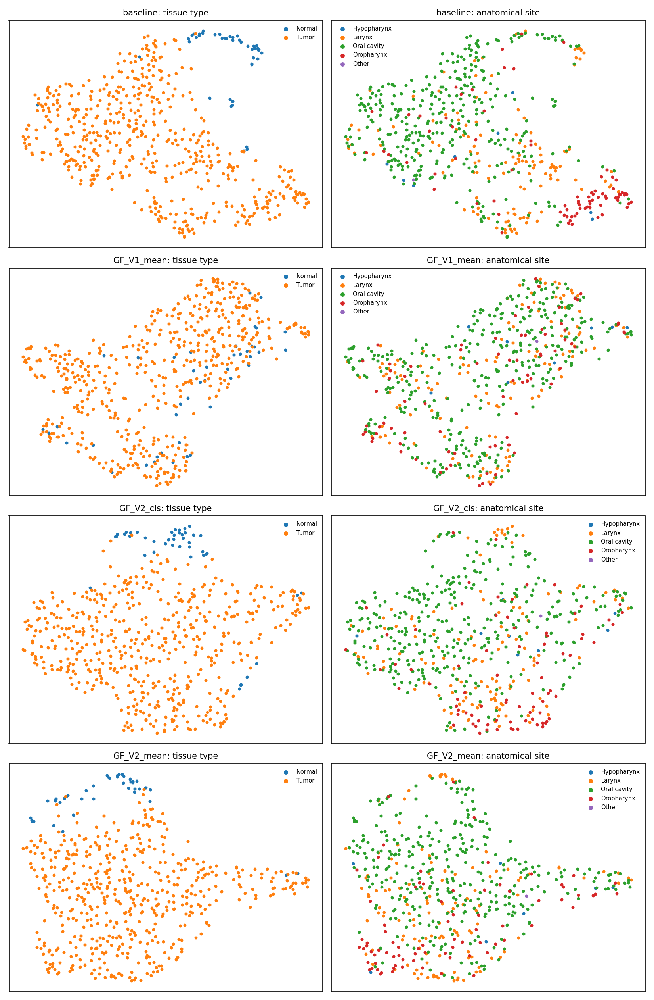
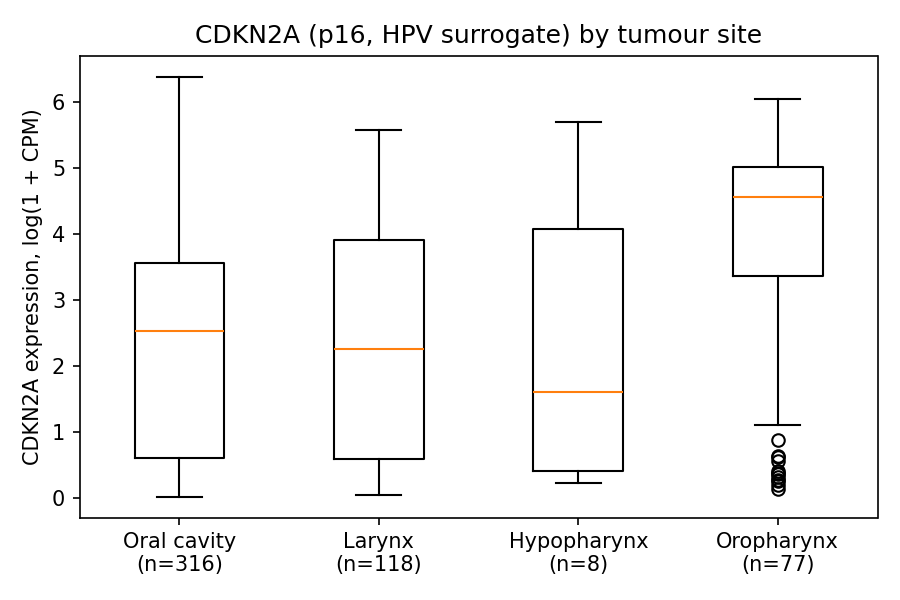
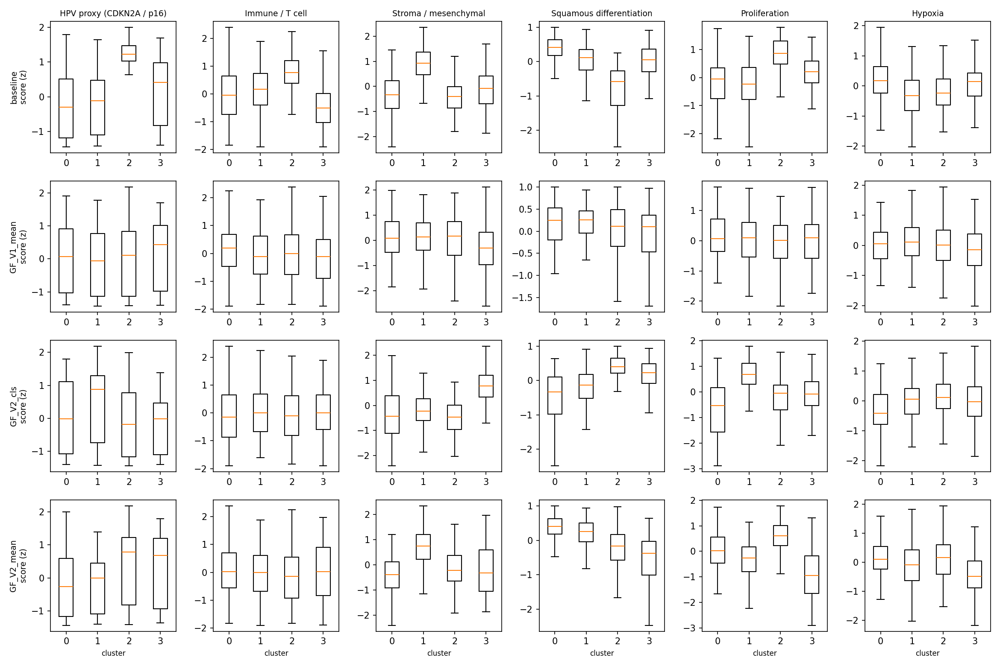
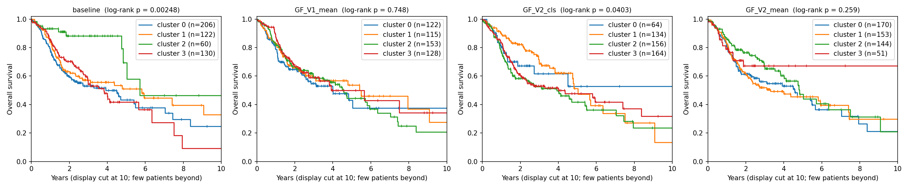

# Geneformer on TCGA-HNSC: unsupervised analysis of head and neck cancer transcriptomes

This repository applies **Geneformer**, a transformer foundation model pretrained on single-cell transcriptomes, to **bulk RNA-seq of 566 head and neck squamous cell carcinoma (HNSC) samples from TCGA**, and compares it with a classical expression pipeline. Tumours are clustered without labels, and the clusters are then tested against clinical data, survival, technical variables and known gene programmes.

**Question:** do zero-shot Geneformer embeddings reveal biologically and clinically meaningful structure in bulk tumour RNA-seq, compared with a standard PCA-based approach?

**Short answer:** the classical pipeline recovered the four published HNSC expression subtypes, including an HPV-like group with much better survival independent of age and stage. The cancer-tuned Geneformer V2 model captured part of this biology, but its strongest axis was technical; the original V1 model captured almost none. Details are in [Results](#results).

---

## Pipeline

```
GDC portal ──► 01 download ──► 02 count matrix ──► 03 clinical cleaning
                                     │                     │
                                     ▼                     ▼
                        04 QC + baseline (log-CPM → HVG → PCA → UMAP)
                                     │
                     05 tokenize (rank value encoding, V1 & V2)
                                     │
                     06 Geneformer embeddings (V1-10M, V2-104M cancer-tuned)
                                     │
            07 clustering: k-means, hierarchical (Ward), Gaussian mixture
               on 4 representations, k = 2 (silhouette) and k = 4 (literature)
                                     │
            08 characterisation: clinical & technical tests, survival
               (Kaplan–Meier, log-rank, Cox), marker genes, gene programmes
```

| Step | Script | What it does | Main output |
|---|---|---|---|
| 01 | `scripts/01_download.sh` | Downloads the 566 STAR-Counts files listed in the GDC manifest | `data/raw/` |
| 02 | `scripts/02_build_matrix.py` | Merges per-sample files into one samples × genes matrix of raw counts | `data/interim/hnsc_counts.h5ad` |
| 03 | `scripts/03_clean_clinical.py` | Collapses GDC clinical data to one row per patient; derives stage, site and overall survival | `results/tables/clinical_clean.tsv` |
| 04 | `scripts/04_qc_baseline.py` | QC, gene filtering, log-CPM, 3,000 variable genes, PCA, UMAP | `results/tables/baseline_pca.csv`, `results/figures/04_*.png` |
| 05 | `scripts/05_tokenize.py` | Converts each sample to Geneformer's rank value encoding | `data/tokenized/` |
| 06 | `scripts/06_extract_embeddings.py` | Runs Geneformer and saves one embedding per sample | `data/processed/emb_*.csv` |
| 07 | `scripts/07_cluster.py` | Clusters primary tumours on each representation; compares methods and representations | `results/tables/cluster_*_k*.csv`, `results/figures/07_*.png` |
| 08 | `scripts/08_characterise_clusters.py` | Tests what each cluster means: clinical, technical, survival, marker genes | `results/tables/08_*.csv`, `results/figures/08_*.png` |
| all | `scripts/run_all.sh` | Runs steps 01–08 in order | everything above |

Raw and intermediate data (`data/`) are not committed; they are fully regenerated from the committed GDC manifest. Figures and result tables are committed under `results/`.

---

## Data

- **Source:** [GDC Data Portal](https://portal.gdc.cancer.gov/projects/TCGA-HNSC), project TCGA-HNSC.
- **Expression:** Transcriptome Profiling → Gene Expression Quantification → RNA-Seq → STAR - Counts, open access. 566 files: **522 tumour, 44 adjacent normal, from 521 patients**; 60,660 genes (GENCODE v36).
- **Clinical:** GDC clinical, exposure and follow-up tables for the same cases.
- The manifest, sample sheet and clinical files used are in `metadata/` (downloaded 15 Nov 2026).
- Raw counts were taken from the `unstranded` column. Its near-equal split between the two stranded columns indicates an unstranded library preparation, and Geneformer's tokenizer requires raw counts.

---

## How to reproduce

Tested on Windows + WSL2 (Ubuntu), CPU only, 7.6 GB RAM available to WSL. No GPU is needed.

### 1. Environments

```bash
# analysis environment
conda create -n gf python=3.10 -y
conda activate gf
pip install -r requirements.txt

# download tool, kept separate because of its own dependencies
conda create -n gdc -c conda-forge -c bioconda python=3.10 gdc-client tenacity -y
```

### 2. Geneformer (code and two pretrained models)

```bash
mkdir -p ~/tools && cd ~/tools
git lfs install
GIT_LFS_SKIP_SMUDGE=1 git clone https://huggingface.co/ctheodoris/Geneformer
cd Geneformer
git lfs pull --include "geneformer/**"
git lfs pull --include "Geneformer-V1-10M/**"
git lfs pull --include "Geneformer-V2-104M_CLcancer/**"
pip install .
pip install "transformers==4.49.0" "huggingface-hub<1.0" "datasets<4"
python -c "import geneformer; print('Geneformer OK')"
```

Geneformer imports a class removed in recent `transformers` releases, so `transformers` is pinned to 4.49.0, with compatible `huggingface-hub` and `datasets`.

### 3. Run

```bash
git clone git@github.com:gm-oogway/geneformer-tcga-hnsc.git
cd geneformer-tcga-hnsc
bash scripts/run_all.sh
```

Approximate run times on a laptop CPU: download depends on the connection (~2.4 GB); steps 02–05 a few minutes; V1 embeddings 4 min; **V2 embeddings about 90 min** (9.3 s per sample, 2.0 GB peak memory); steps 07–08 a few minutes each. Step 06 saves progress every 10 samples and resumes if interrupted.

---

## Methods

**Baseline (step 04).** Genes with ≥ 1 count per million in ≥ 10 % of samples were kept (17,640 of 60,616). Counts were normalised to counts per million and log-transformed (log(1 + CPM)). The 3,000 most variable genes were scaled and reduced by PCA; the first 20 components (60.4 % of variance) were used downstream.

**Geneformer (steps 05–06).** Each sample's raw counts were converted to Geneformer's *rank value encoding*: counts are divided by the sample total and by each gene's median expression in the pretraining corpus, genes are sorted, and the top-ranked genes become the token sequence. Two pretrained models were used **zero-shot** (no fine-tuning):

| Model | Pretraining | Input length | Embedding size | Genes in vocabulary (of ours) |
|---|---|---|---|---|
| Geneformer-V1-10M | ~30 M non-cancer single cells | 2,048 | 256 | 22,077 |
| Geneformer-V2-104M_CLcancer | ~104 M single cells, then ~14 M cancer cells | 4,096 | 768 | 19,906 |

Embeddings were taken from the second-to-last layer, either averaged over gene tokens (`mean`) or, for V2, from the `<cls>` token. Every sample filled the full input length: bulk samples express ~31,000 genes, so each was truncated to its top 2,048 or 4,096 ranked genes.

**Clustering (step 07).** Primary tumours only, one per patient (n = 520). Four representations (baseline PCA, V1-mean, V2-cls, V2-mean), each standardised and reduced to 20 components. k-means, hierarchical clustering (Ward linkage) and Gaussian mixture models were run with **k = 2** (best baseline silhouette) and **k = 4** (the number of published HNSC expression subtypes). Evaluation: silhouette score, k-means stability over 10 random starts (ARI), agreement between methods and between representations (adjusted Rand index).

**Characterisation (step 08).** For k-means clusters of each representation:
- chi-square tests with Cramér's V (site, stage, sex, smoking, grade, collection site) and Kruskal–Wallis tests with ε² (age, library size, genes detected, gene-programme scores); p-values adjusted by Benjamini–Hochberg;
- Kaplan–Meier curves, log-rank test, and Cox regression adjusted for age and stage (reference = largest cluster);
- marker genes by Wilcoxon rank-sum test on log-CPM;
- six gene-programme scores (mean z-score): HPV proxy (CDKN2A/p16), immune/T cell, stroma/mesenchymal, squamous differentiation, proliferation, hypoxia.

---

## Results

### 1. Sanity check: tumour vs normal



The baseline and both V2 embeddings separate the 44 normal samples from tumours without being told which is which. **V1 does not:** normals are scattered through the tumour cloud. The baseline also places oropharyngeal tumours in a distinct region.

### 2. The baseline recovers the four known HNSC subtypes (k = 4)

| Cluster | n | Defining features | Resembles published subtype |
|---|---|---|---|
| 0 | 206 | 81 % oral cavity; squamous differentiation high; SFN, KRT14, PKP3, GJB2 | Basal |
| 1 | 124 | Stroma/EMT programme high (z = +0.89); ZEB1, MEF2C, A2M | Mesenchymal |
| 2 | 60 | 75 % oropharynx; HPV proxy +1.03, immune +0.77, proliferation +0.85; younger; 17 % died | Atypical (HPV-associated) |
| 3 | 130 | 52 % larynx; most current smokers (45 %); SOX2, GPX2, UGT1A1 (oxidative stress) | Classical |

The HPV-like cluster 2 had markedly better overall survival: **Cox hazard ratio 0.29 (95 % CI 0.15–0.57, p < 0.001), adjusted for age and stage** (log-rank p = 0.002). CDKN2A (p16), a clinical HPV surrogate, is strongly raised in oropharyngeal tumours:



### 3. Geneformer V2 captures part of the biology, but its strongest axis is technical

At **k = 2**, V2 gives the highest silhouette (0.31), but the split is lopsided (436 / 84). The 84-sample cluster has lower sequencing depth (46 vs 56 M reads), ribosomal-protein marker genes (RPL34, RPS9, RPLP2…), lower scores on every biological programme, and no association with site or survival (log-rank p = 0.25). It draws from almost all collection sites (7–35 % per site), so it is more consistent with sample-level RNA quality than with a single-hospital batch effect.

At **k = 4**, V2 recovers a stromal cluster (COL5A1, FAP, CALD1), a keratinising cluster (KRT6A, SPRR1B, TGM1, IVL) and a proliferative / partly HPV-like cluster (HR 0.64, p = 0.017), plus the technical cluster. Its clusters partially agree with the baseline (ARI 0.25–0.31), but it does not recover the larynx/smoking (classical) group.



### 4. Geneformer V1 captures almost no biology in bulk tumours

V1 clusters have no marker genes at k = 2, no survival association at any k, flat gene-programme scores, and one k = 4 cluster defined by mitochondrial genes. Together with its failure to separate normal from tumour, this indicates the small non-cancer model does not transfer to bulk TCGA data.



### Summary of clustering metrics

| | Baseline | V1-mean | V2-cls | V2-mean |
|---|---|---|---|---|
| Silhouette, k = 2 / k = 4 | 0.17 / 0.17 | 0.23 / 0.20 | 0.31 / 0.12 | 0.27 / 0.12 |
| k-means stability (ARI), k = 4 | 0.84 | 0.71 | 0.62 | 0.60 |
| Agreement with anatomical site (ARI), k = 4 | 0.19 | 0.00 | 0.08 | 0.08 |
| Survival log-rank p, k = 4 | 0.002 | 0.75 | 0.04 | 0.26 |

Silhouette scores are not comparable across representations, because each is a different space; a higher value for V2 at k = 2 reflects the small, distinct technical cluster, not better biology.

---

## Conclusions

On bulk TCGA-HNSC RNA-seq, a classical unsupervised pipeline recovered clinically meaningful structure that matches published HNSC subtypes, including an HPV-like group with markedly better survival. Zero-shot Geneformer embeddings captured part of this biology only with the cancer-tuned V2 model, and its dominant axis was technical; the original V1 model captured almost none. Likely reasons:

1. **Bulk vs single cell.** Geneformer was pretrained on individual cells; a bulk sample mixes tumour, immune and stromal cells.
2. **Truncation.** Each sample expresses ~31,000 genes, but the model sees only the top 2,048 (V1) or 4,096 (V2).
3. **Rank encoding.** When abundant transcripts such as ribosomal genes crowd the top ranks, the token sequence, and therefore the embedding, changes.
4. **Zero-shot use.** The models were not fine-tuned on this data.

## Limitations

- **HPV status is not available** in the GDC clinical data; CDKN2A expression is a surrogate, so groups are described as "HPV-like".
- **Survival analyses are exploratory:** 4 representations × 2 values of k were tested without correction across them. The HPV-like result (p < 0.001) is robust; results near p = 0.02 are not.
- **Batch effects:** all clusterings are moderately associated with collection site (Cramér's V ≈ 0.27), which is partly confounded with anatomical site. Genes detected per sample is also associated with the baseline clusters.
- **Stage** combines pathologic stage with clinical stage where pathologic was missing (75 patients); pack-years were missing for 224 patients, so smoking status was used.
- The Cox proportional-hazards assumption was not formally tested. Median follow-up is 1.8 years, so Kaplan–Meier tails rest on few patients.
- Only zero-shot embeddings were evaluated; fine-tuning, other pooling layers and other bulk-adapted foundation models were not explored.

## Possible extensions

- Fine-tune Geneformer V2 on a supervised task (tumour vs normal, or site) and re-cluster.
- Obtain HPV status (e.g. from the TCGA 2015 publication supplement) to validate the HPV-like cluster.
- Estimate tumour purity and immune infiltration and include them as covariates.
- Apply the cancer-tuned model to single-cell HNSC data (e.g. GSE103322), where it is in its native setting.

## References

- Theodoris CV et al. Transfer learning enables predictions in network biology. *Nature* 2023.
- Geneformer models and documentation: <https://huggingface.co/ctheodoris/Geneformer>, <https://geneformer.readthedocs.io>
- The Cancer Genome Atlas Network. Comprehensive genomic characterization of head and neck squamous cell carcinomas. *Nature* 2015;517:576–582.
- Walter V et al. Molecular subtypes in head and neck cancer exhibit distinct patterns of chromosomal gain and loss of canonical cancer genes. *PLoS One* 2013;8:e56823.
- GDC Data Portal: <https://portal.gdc.cancer.gov>

## Repository layout

```
├── README.md
├── environment.yml / requirements.txt   # software versions
├── metadata/        # GDC manifest, sample sheet, clinical tables (committed)
├── scripts/         # pipeline steps 01–08 and run_all.sh
├── results/
│   ├── figures/     # all figures
│   └── tables/      # all result tables
└── data/            # raw, interim and processed data (not committed; regenerated by the pipeline)
```
